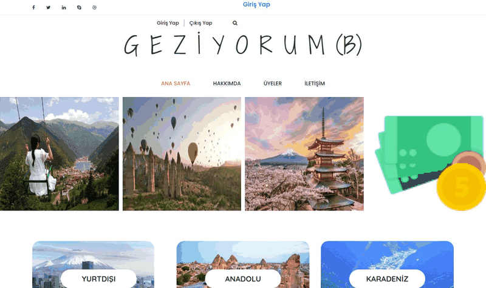
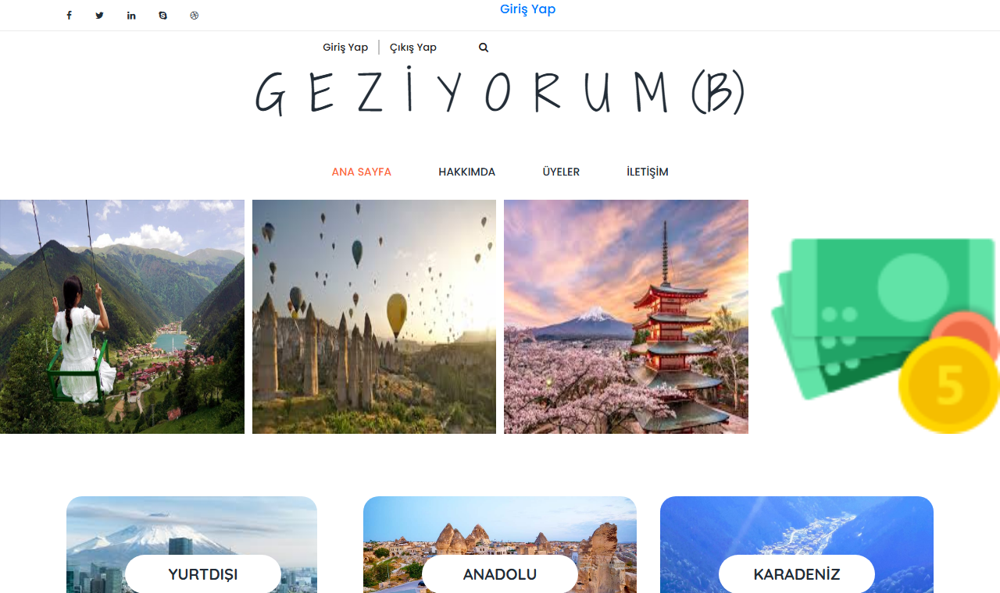
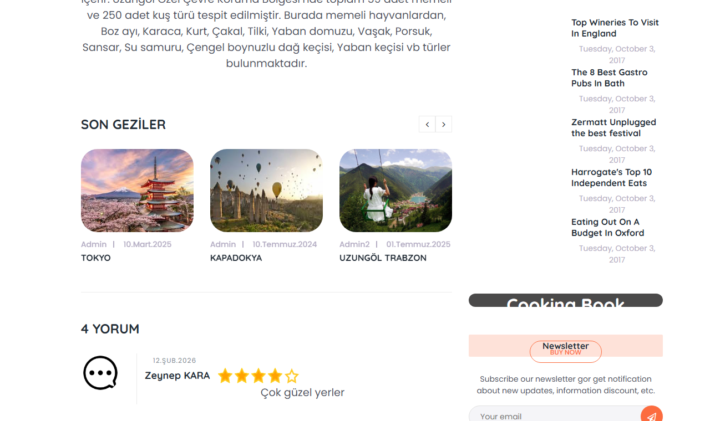

# ✈️ Seyahat Blog Sitesi (ASP.NET MVC)


Gezi yazılarının yayınlandığı, ziyaretçilerin yorum yapabildiği ve yöneticinin tüm içeriği bir panelden yönettiği **ASP.NET MVC 5** blog sitesi.

---

## 🎬 Demo



Ana sayfa, blog detayı (puan, hava durumu, son geziler) ve yönetim paneli girişi.

| Ana sayfa | Blog detayı |
| --- | --- |
|  |  |

> Görüntüler, depodaki kurulum script'iyle kurulan örnek veritabanı üzerinde uygulama çalıştırılarak alınmıştır.


## 🚀 Özellikler

### 🌍 Ziyaretçi tarafı
- Gezi yazıları listesi, sayfalama (**PagedList**) ve detay sayfası
- Yorum yapma ve **yoruma yanıt verme**, 1–5 yıldız puanlama
- Yorum formunda toplama işlemli **güvenlik sorusu** (Session ile doğrulama)
- Son geziler ve içerik sayfaları (partial view'lar)
- **Hava durumu** sayfası (`wttr.in` API'si, JavaScript `fetch`)
- Şehre göre üye arama
- **Üye ol:** Fotoğraf yükleme (WebImage ile 1000 px'e küçültme), şifre tekrarı doğrulaması

### 🛠️ Yönetim paneli
- Blog ekleme / güncelleme, bloglara görsel galerisi ekleme
- Hakkımda sayfası ve içerik (PDF/doküman) yönetimi
- Yorumları gösterme / gizleme / silme (sayfalı liste)

### 🔐 Kimlik doğrulama ve yetkilendirme
- Forms Authentication + Session
- Kullanıcı yetkisi `Y` (yönetici) ise yönetim paneline, `K` (üye) ise siteye yönlendirilir
- Yönetim sayfaları `YoneticiYetki` filtresi ile **yalnızca yöneticilere** açıktır

## 🗄️ Veritabanı (`DbSeyahat25B`)

8 tablo: `TBLBLOG`, `TBLBLOGRESIMLER`, `TBLYORUMLAR`, `TBLKATEGORI`, `TBLICERIK`, `TBLHAKKIMDA`, `TBLKULLANICI`, `TBLUYELER`

## 📂 Proje Yapısı

```
SeyahatMVC25B/
├── Controllers/     ← AnaSayfa (site), AdminBloglar, Icerik, Yorumlar (panel), Login, UyeAra
├── Filters/         ← YoneticiYetkiAttribute (rol kontrolü)
├── Models/          ← Entity Framework modeli (Model1.edmx)
├── Views/           ← Razor görünümleri (LayoutGezi: site, LayoutAdmin: panel)
├── ResimlerGezi/    ← Blog ve üye görselleri
└── Dosyalar/        ← Yüklenen PDF'ler
```

---

## ⚙️ Kurulum

**Gereksinimler:** Visual Studio 2022/2026 (*ASP.NET ve web geliştirme* iş yükü) · SQL Server (Express yeterli) · SQL Server Management Studio (SSMS) 22

1. **İndirin**
   ```bash
   git clone https://github.com/GencayCeliker/Seyahat-Sitesi-MVC.git
   ```
2. **Veritabanını kurun (SSMS 22):** `Veri Tabanı/DbSeyahat25B.sql` dosyasını açıp **Execute (F5)**'e basın.
3. **Bağlantıyı kontrol edin:** `SeyahatMVC25B/Web.config` içinde `data source=.\SQLEXPRESS` kullanılır. Varsayılan SQL Server örneği kullanıyorsanız `data source=.` yapın.
4. **Çalıştırın:** `SeyahatMVC25B.sln` dosyasını açın; NuGet paketleri otomatik yüklenir. **F5** ile IIS Express üzerinde başlatın.

**Demo girişler** (`/Login/Login`, şifre hepsinde `123`):

| Rol | Kullanıcı adı |
| --- | --- |
| Yönetici | `zk` |
| Üye | `a` |

## 📄 Lisans

Bu proje [MIT](LICENSE) lisansı altında sunulmuştur.
